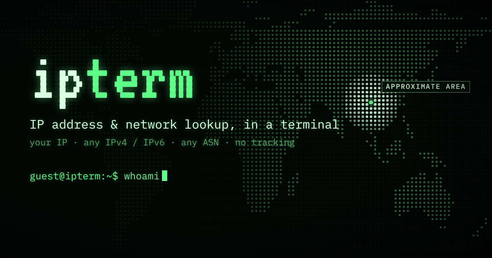

# ipterm

[](https://ipterm.net)

**[ipterm.net](https://ipterm.net)** is a "what's my IP" site that works like a terminal, in your browser and from
`curl`. Look up your own address or any IP, network, domain, mail setup or port. No accounts, no cookies, no tracking.

## Try it

```sh
curl ipterm.net                       # just your IP
curl ipterm.net/me                    # your IP, network and rough location on a Braille world map
curl ipterm.net/line                  # IP, network, country and data center on one line, for a prompt or tmux
curl ipterm.net/8.8.8.8/org           # one value for any address
curl ipterm.net/8.8.8.8/text          # everything about an address, as aligned text
curl ipterm.net/mail/gmail.com        # SPF, DMARC, DKIM and MTA-STS, graded A to F
curl ipterm.net/grade/github.com      # a domain's report card: DNSSEC, email, expiry and security headers
curl -4 ipterm.net/port/22            # is a port open on your own IP?
curl ipterm.net/help                  # everything else
```

In Windows PowerShell, type `curl.exe`: plain `curl` there is `Invoke-WebRequest`.

<details>
<summary>What <code>curl ipterm.net/me</code> looks like</summary>

With documentation values instead of a real address. In a terminal the land is green and your location is lit;
`?w=$COLUMNS` fits it to your terminal, `?color=0` turns colors off and `?redact` hides the IP for screenshots.

```
╭─ ipterm.net/me ──────────────────────────────────────────────╮
│                                                              │
│          ⣀⣠⡤⡀⣄⡶⣿⣿⡛⠻⠷⢿⣿⣿⣿⣿⣿⡗⠉    ⠲⠒     ⡀⠄⢄ ⢀⣀⣴⣶⣦⣤⣀⣀⡀ ⢤       │
│ ⠲⠆⢴⣿⣿⣿⣷⣶⣿⣿⣾⣿⣿⣶⡿⠿⠋⣽⠷⠆ ⢿⣿⠟⠛⠋⠥⠄   ⣠⣴⢿⣿⣷⣶⣶⣶⣶⣷⣿⣿⣿⣿⣿⣿⣿⣿⣿⣿⣿⣿⣿⣿⣿⣿⣿⣾⡷ │
│    ⠉⠁  ⠙⠻⣿⣿⣿⣿⣿⣷⣶⣤⣿⣿⣷⣤       ⠰⣳⣤⣽⣿⣶⣿⣿⣿⣿⣿⣿⣿⣿⣿⣿⣿⣿⣿⣿⣿⣿⣿⣿⣿⣭⠁ ⠞    │
│          ⢿⣿⣿⣿⣿⣿⣿⣿@⠋⠉        ⢰⣾⢟⡛⠻⢿⢿⣭⣽⣿⣝⣿⣿⣿⣿⣿⣿⣿⣿⣿⣿⣿⡿⡟⠋⡔       │
│           ⠙⡿⣿⣿⠛⠛⠏⠁         ⢀⣼⣿⣿⣿⣶⣶⣶⣶⣿⣿⡻⣿⣿⣿⣿⣿⣿⣿⣿⣿⣿⣿⠆⠑⠉⠁       │
│             ⠙⠻⠴⣦⠈⠂⠂        ⣿⣿⣿⣿⣿⣿⣿⣿⣿⣞⣿⠿⠋ ⠈⢿⡿⠋⠹⢿⣿⡋⠁⠅          │
│                ⠈⢀⣾⣿⣷⣦⡄     ⠈⠻⠿⠛⢿⣿⣿⣿⣿⣿⡿⠃   ⠈⠃  ⢴⡍⣀⣤⠐          │
│                 ⠸⣿⣿⣿⣿⣿⣷⣶⠄      ⠈⣿⣿⣿⣿⣏         ⠈⠳⠍⠉⠁ ⠑⠷⢆⠂     │
│                  ⠙⣿⣿⣿⣿⣿⠇        ⣿⣿⣿⣿⠋⣴⠇          ⣀⣴⣾⣿⣼⣆      │
│                   ⣿⣿⣿⠟          ⠘⣿⡿⠃ ⠈           ⣿⡿⠿⢿⣿⣿⠇     │
│                  ⢸⣿⠏⠁                                ⠈⠍   ⡤⠃ │
│                  ⠘⠫                                          │
│ @ about here (your provider's hub, not your home)            │
│                                                              │
│ ip         203.0.113.4  IPv4                                 │
│ network    AS64500  Example ISP                              │
│ location   Newark, New Jersey, United States [US]            │
│ time zone  America/New_York  10:42 (UTC-4)                   │
│ edge       EWR (Cloudflare data center)                      │
│                                                              │
╰─ no cookies · no tracking · ipterm.net/help ─────────────────╯
```

</details>

## In the browser

[ipterm.net](https://ipterm.net) is the same thing as a terminal: type `help`, or click any command. Every result has
its own page to share (`ipterm.net/8.8.8.8`, `ipterm.net/AS13335`, `ipterm.net/dns/example.com`), and `[share] [copy]
[md]` on its header line, where `md` copies it as a Markdown block for an issue or a chat. Tab completes, Ctrl+R
searches your history, and `ipterm.net/go?q=<anything>` works as a browser search engine.

| Command | What it does |
| --- | --- |
| `whoami` | your IP, network and approximate location |
| `leaktest` | a VPN and DNS leak test, graded A to F on leaks only: which DNS servers look up sites for you, WebRTC and IPv6 leaks, your time zone, VPN detection (Cloudflare WARP and Tor by name). `share` copies an IP-free link to the grade |
| `lookup <ip, domain or ASN>` | owner, network and location of any address; a domain's DNS records |
| `dig <name> [type]` | one DNS record type, with TTLs |
| `whois <ip, ASN or domain>` | the registry record, over RDAP |
| `mail <domain>` | email security (MX, SPF, DMARC, DKIM, MTA-STS, TLS-RPT, BIMI), graded A to F |
| `grade <domain>` | a domain's report card, graded A to F: DNSSEC, IPv6, CAA, email, expiry and transfer lock, the redirect to HTTPS and the security headers. `copy badge` gives a README badge drawn by shields.io, so your readers never contact ipterm |
| `port <number>` | is a TCP port open on your own IP? It never tests any other address |
| `cidr <range>` | subnet calculator, IPv4 and IPv6 |

## Privacy

- No accounts, no cookies, no analytics, no ad scripts. ipterm's code stores and logs nothing about visitors.
- Cloudflare, which hosts it, keeps its own records of the traffic: the site's owner sees it mostly in aggregate
  (countries, paths, user agents), plus a sample of individual requests with their IP, from up to the last 31 days.
  Browsers may also send Cloudflare network error reports (NEL).
- The page's Content-Security-Policy is `default-src 'none'`: scripts and styles come only from ipterm itself, and the
  only other hosts it may fetch from are ipify (to show your other IP version) and ipterm's own DNS leak test zone.
  `leaktest` also asks Cloudflare's STUN server which addresses WebRTC reveals.
- Your own address goes to a data provider (IPinfo, proxycheck.io) only when you run `leaktest`.
- One labeled affiliate line (Proton VPN) appears after a leak test whose VPN check ran and found no VPN. It's a plain
  link, and never appears in `curl` output.

The full [privacy policy](https://ipterm.net/privacy) says what each part sees. Every page's footer links to this
repository, and names the exact commit that's running when the site is deployed with `npm run deploy`.

## How it's built

One Cloudflare Worker (`src/worker.js`) and a vanilla JavaScript page (`public/`), with no build step. Your own
address comes from Cloudflare's edge, other addresses from [IPinfo](https://ipinfo.io), networks from RIPEstat,
registry records over RDAP and DNS from Cloudflare's 1.1.1.1. The DNS leak test has its own small DNS server on a VPS
(`dnsleak-server/`).

## Run your own

```sh
npm install
npx wrangler login
npm run deploy
```

Then set `SELF_HOSTED = "true"` in `wrangler.toml`: your copy marks itself `noindex`, shows no sponsored line and says
in its footer that it's a copy of ipterm. Everything else is in the **[handbook](docs/handbook.md)**: the settings and
optional keys (IPinfo, proxycheck.io), the budgets and rate limits, every route and check, security and local
development. The DNS leak test server has its own guide: [dnsleak-server/README.md](dnsleak-server/README.md).

## License

MIT (see `LICENSE`). The fonts in `public/fonts/` keep the SIL Open Font License, and the map outlines come from
[Natural Earth](https://www.naturalearthdata.com/) (public domain). IP address data powered by [IPinfo](https://ipinfo.io).
